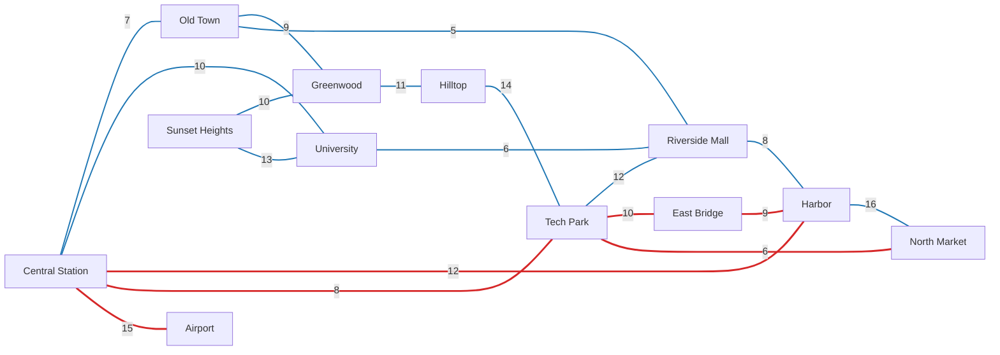

# Rivermede Transit

[](LICENSE)


A smart-city public transport simulator in plain C. It models the bus and train network of a
made-up city as a graph, plans journeys with **BFS** and **DFS**, simulates a day of passengers,
and **profiles both algorithms** by steps and by time.

Project for **Advanced Data Structures and Algorithms**,
University of Colombo School of Computing.

## Highlights

- **Graph model.** Stops are vertices. Bus and train routes are weighted, two-way edges, stored
  as an adjacency list.
- **Two search algorithms.** BFS finds the journey with the fewest rides. DFS with backtracking
  tries every journey and finds the fastest one in minutes.
- **Passenger simulation.** 24 built-in passengers travel at 07:00, 13:00, 18:00 and 22:00, or
  you can type up to 30 passengers of your own.
- **Algorithm profiling.** Steps and microseconds per search, shown for each time of day.
- **One file, no dependencies.** Standard C11 and the C library only (about 530 lines).

## The city of Rivermede

12 stops, 6 train routes (red) and 12 bus routes (blue). The numbers are ride times in minutes.
The Airport and East Bridge have trains only.



## Getting started

### Requirements

A C11 compiler such as GCC or Clang. `make` is optional.

### Build and run

Get the code first:

```bash
git clone https://github.com/HiranthaSandaruwan/rivermede_transit_simulator.git
cd rivermede_transit_simulator
```

With `make` (Linux, macOS, WSL, or MinGW on Windows, where the command is `mingw32-make`):

```bash
make
./transit
```

Without `make`:

```bash
gcc -std=c11 -Wall -Wextra -o transit src/transit.c
./transit
```

On Windows the program is called `transit.exe`; in PowerShell run `.\transit.exe`.

## Using the program

| Option | What it does |
|--------|--------------|
| 1 | Lists the 12 bus routes with their ride times. |
| 2 | Lists the 6 train routes. |
| 3 | Plans one journey. Pick a start stop, an end stop and a time of day. It shows the fastest way (DFS), and the way with the fewest rides (BFS) when that is different, plus the work each search did. |
| 4 | Runs the demo day: 24 built-in passengers, then the algorithm results. |
| 5 | Runs your own passengers (1 to 30), then the same results. |
| 0 | Exits. |

Stops are chosen by number from a list, and every prompt shows the numbers it accepts. A wrong
entry is rejected and asked for again.

Example, planning a journey from Greenwood (10) to Tech Park (3) at 07:00:

```text
Greenwood to Tech Park at 07:00 Morning Peak

Fastest way: 24 min, 3 rides
  1. BUS    Greenwood        to  Old Town          9 min
  2. BUS    Old Town         to  Central Station   7 min
  3. TRAIN  Central Station  to  Tech Park         8 min

Way with fewest rides: 25 min, 2 rides
  1. BUS    Greenwood        to  Hilltop          11 min
  2. BUS    Hilltop          to  Tech Park        14 min

Work done: DFS tried 29 journeys in 257 steps. BFS took 48 steps.
```

The fewest-rides journey is one minute slower here, which is why the program compares the two.
A complete session is in [`docs/sample-session.txt`](docs/sample-session.txt).

## Results

The demo day is profiled by counting **steps** (one step is one stop visited or one route looked
at, counted the same way for both searches) and by measuring **time**.

| Time of day | Passengers | BFS steps | DFS steps |
|-------------|-----------:|----------:|----------:|
| 07:00 Morning Peak | 8 | 384 | 2,882 |
| 13:00 Midday | 5 | 240 | 2,022 |
| 18:00 Evening Peak | 8 | 384 | 5,220 |
| 22:00 Night | 3 | 144 | 1,042 |
| **All day** | **24** | **1,152** | **11,166** |

| Search | Finds | Steps per search | Time per search |
|--------|-------|-----------------:|----------------:|
| BFS | fewest rides | 48.0 | 0.14 µs |
| DFS | fastest way | 465.2 | 3.55 µs |

What the numbers show:

- **BFS costs the same every time**: 12 stops + 36 route checks = 48 steps, which is V + E.
- **DFS costs about ten times more**, because it tries 26.8 journeys per passenger on average.
- **The extra work buys accuracy.** The fastest ways average 16.3 minutes. The fewest-rides ways
  average 16.5 minutes, and are slower for 4 of the 24 passengers.

Steps are the same on every machine. The microsecond timings come from one run on a PC and will
differ on yours.

## How it works

The program has four parts, in this order in [`src/transit.c`](src/transit.c):

1. **City map.** The graph and the Rivermede data.
2. **Finding journeys.** BFS and DFS with backtracking.
3. **Simulation and results.** Passengers, step counters and timing.
4. **Menu.** Input checking and the five options.

[`docs/design.md`](docs/design.md) explains the data structure, both algorithms, how the steps
and times are measured, and the limits of the model.

## Project structure

```text
.
├── src/transit.c            the whole program
├── tests/smoke.sh           scripted end-to-end checks
├── docs/
│   ├── design.md            data structure, algorithms and profiling method
│   └── sample-session.txt   real output of a scripted session
├── Makefile
├── LICENSE
└── README.md
```

## Testing

```bash
make test
```

This builds the program, feeds scripted answers to the menu and checks the lines that never
change: the route lists, the journeys in the examples above, and the step totals of the demo day.
The timings are not checked because they depend on the machine. The test needs a POSIX shell
(Linux, macOS, WSL or Git Bash).

## Limitations and ideas

- The map is built into the code. Loading it from a file would let anyone try their own city.
- The time of day only groups the passengers. The network and ride times are the same all day;
  timetables, waiting times and crowding are not modelled.
- DFS tries every journey, which is fine for 12 stops but grows very fast on a large map.
  Dijkstra's algorithm would be the better choice for the fastest journey on a bigger network.

## Credits and license

Built by Group 03 for IS2202. The program is split into four parts, one for each member.

Released under the [MIT License](LICENSE).
